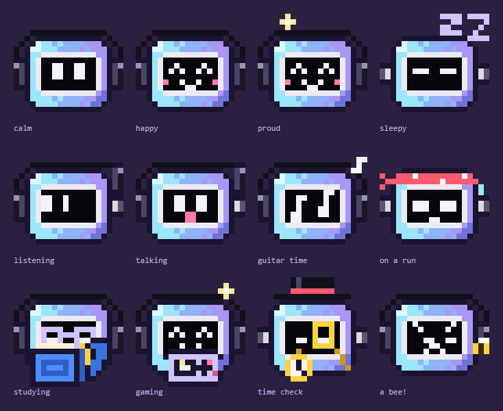
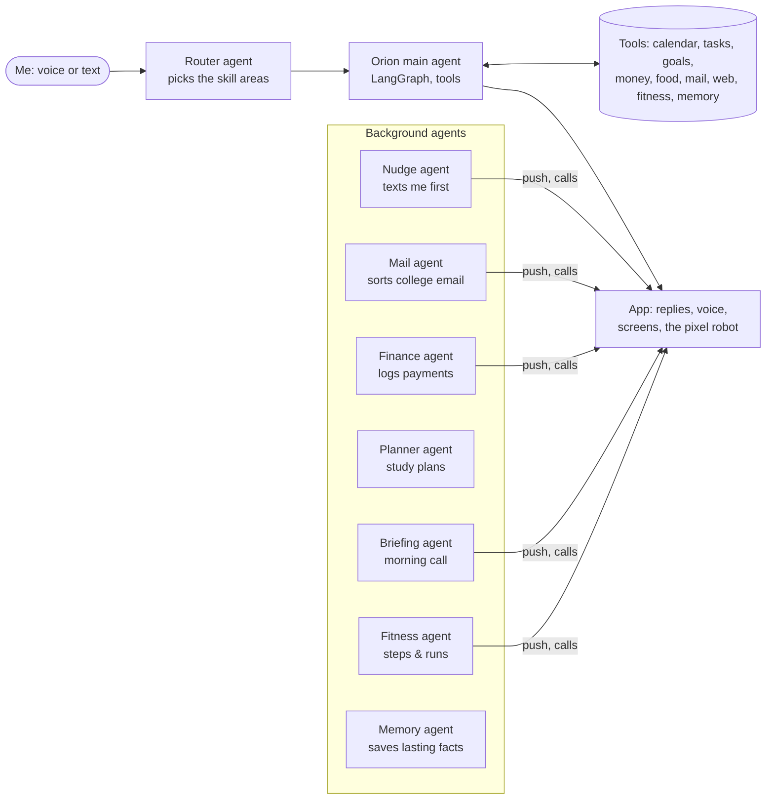

  

<h1 align="center">Orion</h1>

  <b>A voice-first, agentic personal assistant that runs my college life, and texts me first.</b> 
  Android app + laptop web app · a team of AI agents · free to run

  <a href="https://pranavvjay.github.io/Orion-showcase/"><b>Live showcase</b></a> ·
  <a href="https://pranavvjay.github.io/Orion-showcase/privacy.html">Privacy policy</a>

---

Orion is my own AI assistant. I talk to it (or type), and it plans my day, rings me every morning
with a briefing, tracks my goals, money, food, steps and college email, follows the news I care
about, and starts conversations on its own like a friend would. It lives on my phone and laptop,
with its brain running on my laptop, entirely on free tiers.

> The source code is private. This repo holds the public showcase page and the privacy policy
> (needed for Google sign-in).

## Meet her

Orion's face is a little pixel robot whose mood follows my day: proud at 10k steps, sleepy late
at night, worried when I'm over budget. She pushes a headphone cup off to listen when I talk,
copies whatever is on my timetable (music notes at guitar time, a bandana on runs, specs and a
book while I study), and in free time plays her handheld, checks a pocket watch or glares at a bee.

  

## What it does

| | |
|---|---|
| **Talks like a friend** | Natural voice conversations on phone and laptop; short spoken replies; keeps the chat going |
| **Texts you first** | A friendly check-in once a day that follows up on what I told it, plus nudges when something matters |
| **Calls** | Rings my phone like a real call: morning briefing, evening recap, or "call me at 4 about the lab report" |
| **Calendar & to-dos** | Google Calendar and Tasks by voice; changes show live in the real calendar app |
| **Study planner** | Give it a syllabus and a deadline: it splits the topics around my timetable and books every session |
| **Goals & streaks** | Habits with weekly targets, check-ins, streaks and an evening recap |
| **Money** | Logs payments from bank emails, sorts needs vs wants, asks what each one was for |
| **Food** | Snap a plate: dishes, portions, calories and protein, using the real mess menu |
| **Steps & runs** | Reads my watch and Strava runs via Health Connect; cheers 10k days and compares runs |
| **College mail** | Sorts deadlines, class changes, events and exams; "track hackathons in my mail" pings me on new ones |
| **News & web** | Follows stories I care about, reads any link I share, searches the web for live answers |
| **Slides** | Upload lecture slides and it walks me through them out loud |
| **Memory** | Remembers routines, people and preferences across devices |

## How it's built

A small team of agents instead of one big prompt: a router decides which skills a message needs, so
the main agent only sees a handful of tools; background agents work on their own schedules.

## Stack

| Layer | Tech |
|---|---|
| Brain | Groq (open-weight LLMs, Whisper), LangGraph agents with tool calling, a rate-limit-aware fallback chain |
| Backend | Python, FastAPI, SQLite, local embeddings (fastembed) for memory |
| Integrations | Google Calendar, Tasks and Gmail APIs; Health Connect; Google News |
| App | Expo / React Native (Android + web), custom Kotlin module (calls, picture-in-picture, Clock app) |
| Look | Hand-made pixel art and pixel effects (pixelfx), Silkscreen / Pixelify Sans / Nunito |
| Plumbing | Expo push + Firebase, over-the-air updates, Tailscale to reach the laptop from anywhere |
| Cost | Free: every service runs on a free tier |

## Privacy

Orion only ever runs for me. My data stays on my own laptop; Google data is used only to show it back
to me. Details: [privacy policy](https://pranavvjay.github.io/Orion-showcase/privacy.html).

---

Built by <a href="https://github.com/Pranavvjay">Pranav</a> · a personal project, still growing

